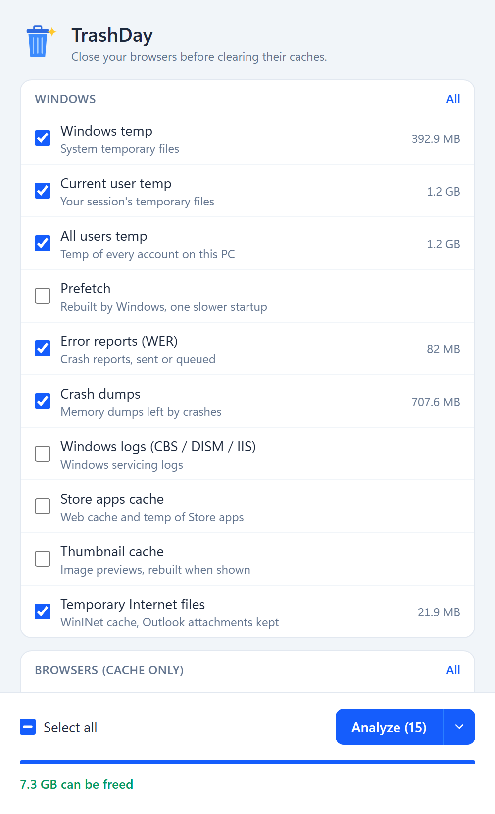
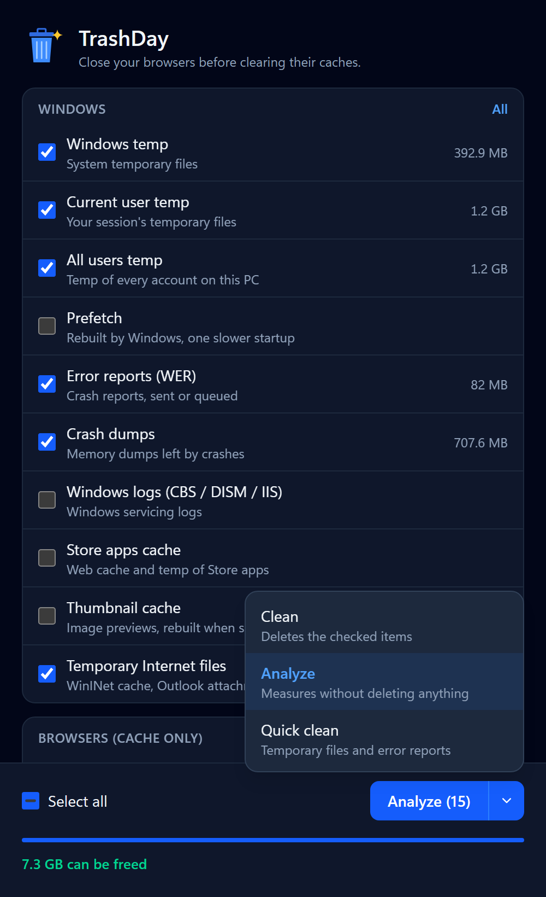

<p align="center">
  
</p>

<h1 align="center">TrashDay</h1>

<p align="center">
  <b>No ads. No malware. Open source. Light and fast.<br>Just clean up your PC, safely.</b>
</p>

<p align="center">
  A tiny disk cleaner <b>for Windows only</b> that clears caches, temp files and logs, never your data, settings or logins.
</p>

<p align="center">
  <a href="https://github.com/Sannho/trashday/releases/latest"></a>
  <a href="https://github.com/Sannho/trashday/actions/workflows/build.yml"></a>
  
  
  
</p>

<p align="center">
  
  &nbsp;&nbsp;
  
</p>

## Why TrashDay

- **No ads, no upsell, no telemetry.** TrashDay itself makes no network requests.
- **No malware, nothing hidden.** Every line is here. Release builds are made by GitHub Actions from this code, with a SHA-256 checksum.
- **Open source.** Read [`targets.go`](targets.go) to see every folder it can touch.
- **Lightweight.** One ~3 MB exe. No installer, no background service, nothing left running after you close it.
- **Fast.** It starts quickly and just deletes files: no "deep scan" theater, no registry tricks.

## Features

- **Three actions** behind one button:
  - **Clean** deletes the checked items.
  - **Analyze** shows how much each item would free, without deleting anything.
  - **Quick clean** runs a fixed, safe set: temp folders, error reports, crash dumps, temporary Internet files.
- **Safe by design**:
  - Only caches, temp files and logs that apps rebuild on their own.
  - No browser history or cookies, no Recycle Bin, no registry "cleaning".
  - Symlinks and junctions are never followed nor removed, so a cache you moved to another drive stays as you set it up.
  - Paths come from environment variables that are checked first: a bad `%TEMP%` or an empty variable can never widen what gets deleted.
  - Outlook's opened attachments (`Content.Outlook`) are always kept.
  - Files in use are skipped and reported.
- **What it cleans**:
  - **Windows**: temp folders (all users), Prefetch, error reports, crash dumps, servicing logs, Store apps cache, thumbnails.
  - **Browsers (cache only)**: Firefox, Chrome, Edge, Brave, Opera.
  - **Apps**: shader caches (DirectX / NVIDIA / AMD / Intel), Steam, Epic Games Launcher, Discord, VS Code, Java.
  - **Dev caches**: Go build, npm, Yarn, pip, NuGet.
- **Small and portable**: one ~3 MB `.exe`, no installer. The UI uses the WebView2 runtime that ships with Windows 11.
- **Light & dark** theme and **English / French**, following your Windows settings.
- **Remembers** your selection and last action.

## Download

Grab `trashday.exe` from the [latest release](https://github.com/Sannho/trashday/releases/latest). No installer: just run it.

- **Windows 10 or 11 only.** Windows 10 may need the [WebView2 runtime](https://developer.microsoft.com/microsoft-edge/webview2/); Windows 11 already has it.
- The exe is not code-signed, so Windows SmartScreen may warn the first time: click **More info → Run anyway**.
- To check the download, compare its hash with `trashday.exe.sha256` from the release: `Get-FileHash trashday.exe`

## Usage

Run `trashday.exe`, pick an action with the arrow, then press the button. Start with **Analyze** to see what can be freed.

TrashDay asks for administrator rights when your account has them, so it can clean the system folders. On a standard account it cleans your own files, and system folders show as skipped.

> Close your browsers before clearing their caches: files in use are skipped.

## Build

Requires Windows and [Go](https://go.dev/dl/) 1.26+.

```powershell
.\build.ps1
```

The script:

1. Downloads the [Tailwind CSS](https://tailwindcss.com) standalone CLI on first run and checks its SHA-256.
2. Builds the stylesheet.
3. Runs the tests.
4. Embeds the icon and manifest.
5. Produces `trashday.exe`.

## How it works

| File | Role |
|---|---|
| [`targets.go`](targets.go) | Every item: its paths (globs from checked env vars), texts in English and French |
| [`clean.go`](clean.go) | Empties each matched folder but keeps the folder itself; dry-run for Analyze |
| [`main.go`](main.go) | Opens the [go-webview2](https://github.com/jchv/go-webview2) window and runs cleaning in the background |
| [`index.html`](index.html) | The whole UI, styled with Tailwind |

## Contributing

Ideas, new safe targets and fixes are welcome: see [CONTRIBUTING.md](CONTRIBUTING.md). AI coding agents: read [AGENTS.md](AGENTS.md) first.

TrashDay is a modern take on the old freeware **ATF Cleaner**.
